# IBIF napari user guide

A practical guide to segmenting, measuring and classifying cells and tracing filaments in
3D fluorescence microscopy images with **IBIF napari**. It is written for graduate students
in the biomedical sciences. No programming is needed, and the guide explains the image-analysis
ideas behind each step so you can choose settings sensibly and describe them in a methods
section.

> **About the screenshots.** The pictures in this guide were taken from the real program
> running on a *synthetic* sample: computer-generated cells with a nuclear stain (DAPI),
> a membrane stain and two surface markers (CD3, CD8), and a computer-generated neuron. For
> the screenshots only, a simple classical watershed stood in for the Cellpose model, so the
> nuclei outlines in the pictures are not Cellpose's. Your own images and results will look
> different.

---

## Contents

1. [What IBIF napari does](#1-what-ibif-napari-does)
2. [Key ideas before you start](#2-key-ideas-before-you-start)
3. [Installing and starting](#3-installing-and-starting)
4. [The window](#4-the-window)
5. [Opening your images](#5-opening-your-images)
6. [Configuration: moving through time, positions and Z](#6-configuration-moving-through-time-positions-and-z)
7. [Segmentation with Cellpose](#7-segmentation-with-cellpose)
8. [Secondary objects: cells, cytoplasm, rings and rims](#8-secondary-objects-cells-cytoplasm-rings-and-rims)
9. [Measurements](#9-measurements)
10. [Cytometry: gating, phenotypes and clustering](#10-cytometry-gating-phenotypes-and-clustering)
11. [Filament tracing](#11-filament-tracing)
12. [Saving your work](#12-saving-your-work)
13. [Using a GPU server or cluster](#13-using-a-gpu-server-or-cluster)
14. [Good practice and reporting your analysis](#14-good-practice-and-reporting-your-analysis)
15. [Can I trust the numbers? Verification and validation](#15-can-i-trust-the-numbers-verification-and-validation)
16. [Troubleshooting](#16-troubleshooting)
17. [Glossary](#17-glossary)
18. [References](#18-references)

---

## 1. What IBIF napari does

IBIF napari is [napari](https://napari.org), an open-source multi-dimensional image viewer
for Python (Sofroniew et al.), with an analysis panel built in. A typical analysis
looks like this:

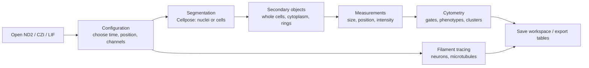

| Section | What it is for | Main method |
|---|---|---|
| Configuration | Move through time points, stage positions and Z; turn channels on and off; 2D/3D view | — |
| Segmentation | Find each nucleus or cell and give it a number | [Cellpose](https://www.cellpose.org) deep-learning segmentation |
| Secondary objects | Build whole cells, cytoplasm, rings or rims from the first objects | Distance transforms and seeded watershed |
| Measurements | Measure every object: size, position and intensity in every channel | Per-object statistics |
| Cytometry | Classify objects into cell types by gating or clustering | Gating, UMAP / t-SNE / PCA, Leiden / Louvain / k-means |
| Filament tracing | Trace and measure branched filaments (neurons, microtubules) | Multi-scale Hessian "tubeness", skeletonization |
| Save workspace | Save everything to come back to later or share | — |

Everything else is ordinary napari, so the napari documentation applies:
[napari.org/stable/tutorials](https://napari.org/stable/tutorials/index.html).

---

## 2. Key ideas before you start

If you are new to quantitative image analysis, these few ideas will make the rest of the
guide much easier to follow.

**Pixels, voxels and physical size.** A 2D image is a grid of *pixels*; a 3D stack is a grid
of *voxels*. Each has a physical size in micrometres (µm), read from your microscope file.
IBIF napari works in µm wherever it can (volumes, distances, diameters, centroids), so
results from different objectives or zoom settings are comparable.

**Anisotropy.** In most confocal and widefield stacks the Z step (for example 1 µm) is larger
than the XY pixel size (for example 0.2 µm). The voxels are then not cubes but tall boxes,
and the image is *anisotropic*. If this is ignored, objects look squashed in Z and distances
along Z are wrong. IBIF napari reads the voxel size from the file and corrects for it
automatically. You should still check it (see [Opening your images](#5-opening-your-images)).

**Channels.** Each fluorophore is recorded as a separate channel. IBIF napari shows each
channel as its own *layer*, named from the file and coloured from its emission wavelength.

**Segmentation and labels.** *Segmentation* means deciding which pixels belong to which
object. The result is a *labels* image: every pixel holds a number, 0 for background and
1, 2, 3, … for the objects. Object 17 is simply all pixels with value 17.

**Primary and secondary objects.** Nuclei are usually the easiest objects to find because a
DNA stain gives a bright, compact, well-separated signal. These *primary objects* then serve
as *seeds* for harder *secondary objects* such as whole cells, whose edges are less clear.
IBIF napari keeps the **same number** for related objects: nucleus 17, cell 17 and
cytoplasm 17 belong together. This is the same idea as CellProfiler's primary and secondary
objects (Stirling et al. 2021).

**Layers.** napari shows a stack of layers: image layers (your channels), labels layers
(segmentations), shapes and points layers (drawings and clicks). The layer list is on the
left of the window; the selected layer's controls (contrast, colour, opacity, brush size)
are above it.

**Time points and positions.** A file can hold several time points (a time lapse) and several
stage positions (multipoint or tiles). Most sections work on the *current* time point and
position, shown in Configuration, and some can process all of them.

---

## 3. Installing and starting

Use a fresh conda environment (Python 3.10–3.12).

```bash
conda create -n ibif-napari python=3.11 -y
conda activate ibif-napari
pip install "git+https://github.com/CU-IBIF/Napari_Cellpose"
ibif-napari --download-models     # fetch the Cellpose weights once (about 1.2 GB)
```

**NVIDIA GPU (optional, strongly recommended for 3D).** On Windows and Linux, `pip` installs
a version of PyTorch from PyPI that may not use your GPU. Install the CUDA build of PyTorch
*before* IBIF napari, choosing the command for your system at
[pytorch.org/get-started/locally](https://pytorch.org/get-started/locally/). Check that it
works with:

```bash
python -c "import torch; print(torch.cuda.is_available())"
```

which should print `True`. Apple Silicon Macs use their GPU automatically. If you have no
GPU, everything still works on the CPU, only more slowly; for large 3D data your facility may
offer a [GPU server or cluster](#13-using-a-gpu-server-or-cluster).

**Start the program** from the same environment:

```bash
conda activate ibif-napari
ibif-napari                      # the viewer with the analysis panel
ibif-napari my_stack.nd2         # ...and open a file
```

Keep the terminal window open: Cellpose prints its progress and any errors there.

**Updating:**

```bash
pip install --upgrade "git+https://github.com/CU-IBIF/Napari_Cellpose"
```

---

## 4. The window

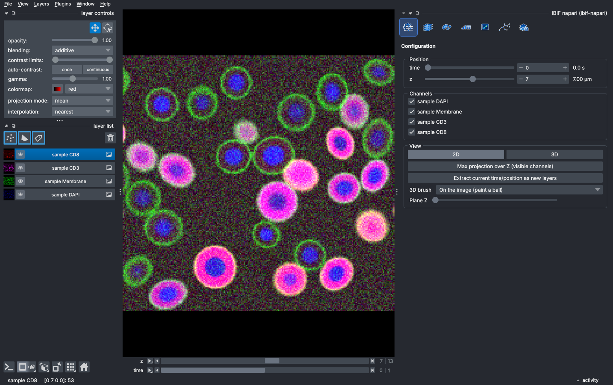

*The IBIF napari window. Left: the layer controls and layer list (one layer per channel).
Centre: the image canvas, with napari's own sliders underneath. Right: the IBIF napari
panel, here on its Configuration section.*

The panel on the right has a row of icon buttons, one per section. Hover over a button to see
its name and what it does; click it to switch section. The current section's name is shown
under the buttons.

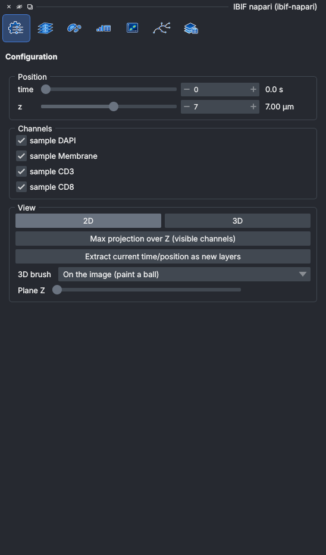

*The panel. The buttons are, from left to right: Configuration, Segmentation, Secondary
objects, Measurements, Cytometry, Filament tracing and Save workspace.*

Useful napari basics:

- **Zoom** with the mouse wheel; **pan** by dragging. Double-click to zoom in.
- **Contrast**: select an image layer and drag the *contrast limits* slider in the layer
  controls. This changes only the display, never the data or the measurements.
- **Show or hide** a layer with the eye icon in the layer list.
- **Opacity** and **blending** for overlays are in the layer controls.
- Each section of the panel can also be opened on its own from **Plugins > IBIF napari**.

---

## 5. Opening your images

IBIF napari reads **Nikon ND2**, **Zeiss CZI** and **Leica LIF** files directly. Drag a file onto
the window, use **File > Open**, or give it on the command line. Files load *lazily*: only
the planes you look at are read, so even large time lapses open quickly.

When a file opens:

- every **channel** becomes its own image layer, named after the file and the channel
  (for example *sample DAPI* for the DAPI channel of `sample.nd2`) and coloured from its
  emission wavelength;
- the **voxel size** (µm) and **time interval** are read from the file, so sliders show µm
  and seconds, and measurements are in physical units;
- for **CZI** files, scenes of the same size become a "position" slider; tiled (mosaic)
  acquisitions are stitched;
- for **LIF** projects with several images, a chooser lists the images and their sizes. Tick
  the ones to open, or double-click one. Images of the same size can be stacked onto the
  position slider.

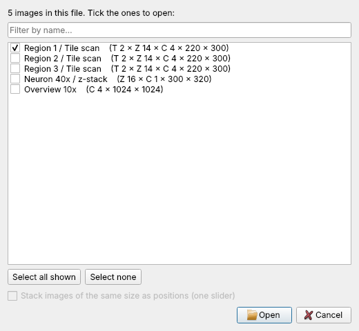

*The chooser shown for a LIF project with several images.*

> **Check the metadata.** Before measuring anything, check that the voxel size is right:
> select a layer and look at its *scale* (napari's **Layers > Layer properties**, or hover
> over the image and read the coordinates in µm at the bottom of the window). Files exported
> through other software sometimes lose the calibration. Wrong voxel sizes give wrong
> volumes, distances and diameters, and a wrong Z step also misleads 3D segmentation.

If another installed plugin can also read CZI or LIF files, napari asks which reader to
use; choose **IBIF napari**.

---

## 6. Configuration: moving through time, positions and Z

The **Configuration** section (first button) is where you choose what you are looking at.

- **Position** has a labelled slider for each of time, stage position and Z. Time is shown in
  s or min and Z in µm.
- **Channels** has a switch for each channel layer.
- **View**:
  - **2D / 3D** switches between viewing one plane and a 3D rendering of the stack.
  - **Max projection over Z (visible channels)** adds a maximum-intensity projection layer of
    each visible channel: every pixel shows the brightest value along Z. Projections are
    good for overviews and figures, but measure in 3D where you can: a projection merges
    objects that lie above one another.
  - **Extract current time/position as new layers** copies the current 3D volume out as new
    layers, for example to save or share one time point.
  - **3D brush** sets how painting on a labels layer works in the 3D view (see below).

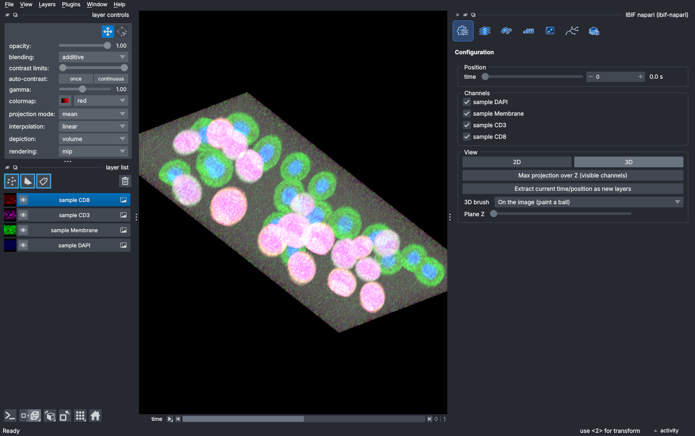

*The 3D view. Drag to rotate, scroll to zoom. The voxel size is used, so the stack has its
true proportions.*

**Painting labels in 3D.** napari's own brush can only repaint existing labels in the 3D view.
IBIF napari adds a 3D brush, chosen under **3D brush**:

- **On the image (paint a ball)**, the default: the brush paints a ball, round in µm, where
  the mouse points at the visible signal. Rotate the view to paint around an object.
- **On a Z plane**: the image shows a single plane, moved with the **Plane Z** slider, and the
  brush paints a disc on it.
- **napari default (existing labels only)**: napari's own behaviour.

You will use painting to mark regions to segment or trace (sections 7 and 11), and to
correct segmentations by hand.

---

## 7. Segmentation with Cellpose

### 7.1 What Cellpose is

[Cellpose](https://www.cellpose.org) is a deep-learning method for segmenting cells and nuclei
(Stringer et al. 2021). Instead of thresholding brightness, a neural network trained on
many thousands of hand-annotated images predicts, for every pixel, the probability that it
is inside a cell and a *flow* pointing towards the cell's centre. Pixels whose flows lead to
the same centre become one object. This lets Cellpose separate touching cells of irregular
shape, which classical thresholding cannot do well.

Which models you get depends on the Cellpose version installed:

| Cellpose version | Models | Notes |
|---|---|---|
| 4 (installed by default) | `cpsam_v2` (default), `cpsam` | **Cellpose-SAM**, a generalist model built on the Segment Anything image encoder (Pachitariu et al. 2025). Handles most stains, sizes and noise levels without choosing a model. |
| 3 | `cyto3`, `nuclei`, `cyto2`, `cyto` | `cyto3` for cells, `nuclei` for nuclear stains (Stringer & Pachitariu 2025). |
| any | your own model file | Trained in the Cellpose GUI on your own annotated images (Pachitariu & Stringer 2022). Type its path in **Model** or click **…**. |

For most data, start with the default model. If it misses or merges objects in your images,
a model fine-tuned on a few of your own annotated images usually fixes it; see the Cellpose
[training documentation](https://cellpose.readthedocs.io/en/latest/train.html).

### 7.2 Running it

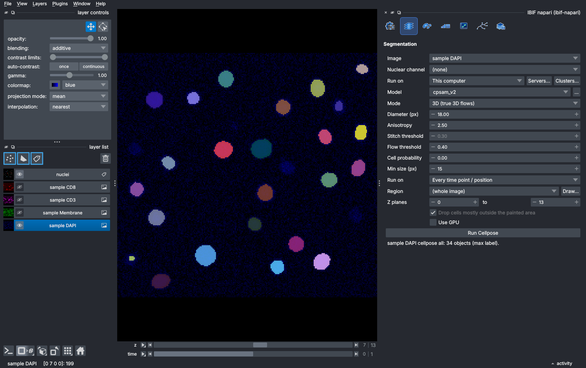

*The Segmentation section after segmenting the nuclei (DAPI) in 3D. The result is a new
labels layer, here renamed* nuclei, *with each nucleus in its own colour.*

1. Go to the time point and position you want in **Configuration**.
2. In **Segmentation**, choose the **Image** to segment:
   - to find **nuclei**, choose the nuclear channel (e.g. DAPI) and leave
     **Nuclear channel** empty;
   - to find **whole cells**, choose a cytoplasm or membrane channel and, if you have one,
     the nuclear channel as **Nuclear channel**. Cellpose uses it as a second input,
     which helps it separate neighbouring cells.
3. Choose the **Mode**:
   - **3D (true 3D flows)** segments the stack as a volume. This is usually the best choice
     for 3D data. The **Anisotropy** (Z step ÷ XY pixel size) is filled in from the file.
   - **2D per plane, stitched** segments each Z plane on its own and joins masks on
     neighbouring planes that overlap by more than the **Stitch threshold** (intersection
     over union). It is faster and uses less memory, and suits thick Z steps where 3D
     flows have little to work with.
4. Leave **Diameter (px)** on *auto* to begin with, or enter the typical object diameter in
   XY pixels. You can measure a few objects with napari's ruler or read their size from the
   coordinates at the bottom of the window.
5. Choose **Run on**: the **Current time point / position**, or **Every time point /
   position**.
6. Tick **Use GPU** if you have one (it is ticked automatically when one is found).
7. Click **Run Cellpose**. The status line shows progress. **Cancel** stops at once.

The result is a labels layer named after the image (for example *sample DAPI cellpose T0*,
or *… cellpose all* for every time point). You
may want to rename it (double-click its name in the layer list), for example to *nuclei*.

### 7.3 Settings

| Setting | What it does | When to change it |
|---|---|---|
| **Model** | Which Cellpose model to use | A specialised or custom model fits your data better |
| **Mode** | 3D flows, or 2D per plane with stitching | See above |
| **Diameter (px)** | Expected object diameter in pixels; images are rescaled so objects match the size the model was trained on. *auto* uses the model's default | Objects much smaller or larger than ~30 px, or many missed / split objects |
| **Anisotropy** | Z step ÷ XY pixel size; set from the file | Only if the file's calibration is wrong |
| **Stitch threshold** | 2D mode: overlap needed to join masks on neighbouring planes | Raise if different cells are joined across Z; lower if one cell breaks into pieces |
| **Flow threshold** | Maximum allowed error of the flows of a mask (default 0.4). Higher keeps more, less accurate masks | Raise if objects are missing; lower if odd-shaped false objects appear |
| **Cell probability** | Threshold on the probability of being inside a cell (default 0). Lower gives larger and more masks | Lower for dim objects; raise if masks spill into background |
| **Min size (px)** | Masks with fewer pixels/voxels are removed | Raise to remove debris |
| **Region**, **Z planes** | Segment only part of the image (see below) | Large images, or only some cells matter |
| **Drop cells mostly outside the painted area** | Removes objects that lie mostly outside a painted region | Keep on for irregular painted regions |

The Cellpose documentation explains these settings in more depth:
[cellpose.readthedocs.io/en/latest/settings.html](https://cellpose.readthedocs.io/en/latest/settings.html).

### 7.4 Segmenting only part of the image

3D segmentation of a large volume can take minutes on a CPU. To segment only the cells you
care about:

1. Optionally set **Z planes** (for example 10 to 25).
2. Click **Draw…** next to **Region**. This adds a *region* labels layer in paint mode.
3. Paint roughly over the cells. In 2D, what you paint on one plane is copied to every plane
   of the Z range, so you see exactly the block that will be segmented. In the 3D view, the
   brush paints balls on the cells and the region keeps that 3D shape.
4. **Run Cellpose.** Only the bounding box of the region is read and segmented, and the
   result is placed over the image where it belongs.

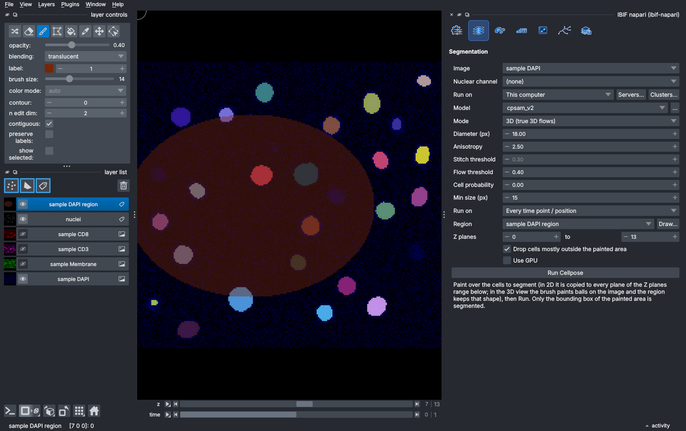

*A painted region (the shaded area). Only this part of the stack is segmented.*

You can also choose an existing labels layer, or a shapes layer with a rectangle, as the
region.

### 7.5 Checking and correcting the result

Always look at the segmentation before measuring it:

- Step through Z and compare the labels with the image. Lower the labels layer's opacity or
  tick *contour* in its layer controls to see the image underneath.
- Look for **merged** objects (two nuclei in one colour), **split** objects (one nucleus in two
  colours), **missed** objects and **false** objects in the background.
- Small fixes can be made by hand on the labels layer with napari's brush, eraser and fill
  tools (the 3D brush works in the 3D view). Pick an unused label number for new objects.
- If errors are frequent, change the settings, try another model, or train a custom model.

---

## 8. Secondary objects: cells, cytoplasm, rings and rims

The **Secondary objects** section makes new objects from a first segmentation, usually
nuclei. **Every new object keeps the number of the object it came from**, so measurements of
nucleus 17, cell 17 and cytoplasm 17 can be joined. All distances are in µm, using the real
voxel size, so 3D stacks are handled correctly.

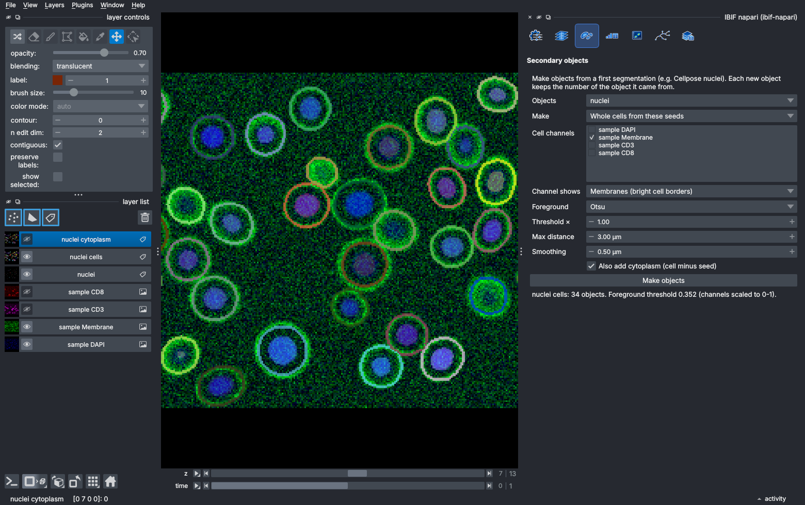

*Whole cells (outlines) grown from the segmented nuclei (filled) in the membrane channel, with
the default Otsu foreground and a 3 µm maximum distance.*

Choose the **Objects** to start from (for example *nuclei*) and what to **Make**:

| Method | Result | Typical use |
|---|---|---|
| **Expand (dilate)** | Each object grown by a **Distance**. Where two objects meet, each pixel goes to the nearer one, so neighbours never merge. | An approximate cell around each nucleus when there is no cell stain |
| **Ring around each object** | A band starting a **Gap** from the edge, of a given **Width** | Perinuclear signal, for example nuclear-to-cytoplasmic translocation |
| **Rim inside each object** | The band just inside the edge, of a given **Width** | Nuclear envelope or membrane-associated signal |
| **Whole cells from these seeds** | Each seed grown into its cell in a cell-stain channel | Whole cells from a membrane or cytoplasm stain |

**Whole cells from these seeds** is the most powerful option. Its settings:

- **Cell channels**: the channel(s) that show the whole cells. If you tick several, each is
  scaled to 0–1 and they are averaged, so a dim and a bright stain count equally.
- **Channel shows**:
  - **Membranes (bright cell borders)**: a seeded watershed on the image. Each cell grows
    from its nucleus until it meets a bright border. The inside of a cell is often as dark
    as the background in a membrane stain; dark areas enclosed by membrane (in each Z
    plane) are therefore counted as cell when they contain a nucleus. An enclosed space
    with no nucleus, such as a lumen, stays background.
  - **Cytoplasm (bright cell interior)**: a compact watershed on the image gradient, which
    stops where the brightness changes (the cell edge). The nucleus, often dark in a
    cytoplasm stain, is first filled in with the surrounding brightness.
  - **Distance only (ignore intensity)**: every foreground pixel goes to the nearest seed.
- **Foreground**: which pixels count as cell, from an automatic threshold of the channel:
  **Otsu** (Otsu 1979), **Li** (minimum cross-entropy; Li & Tam 1998), **Triangle**
  (Zack et al. 1977), a **Manual** value, or **None (whole image)**. **Threshold ×**
  multiplies the automatic threshold; lower values give larger cells.
- **Max distance**: the furthest a cell may reach from its seed, which stops cells running
  into empty space.
- **Smoothing**: a Gaussian blur (µm) before thresholding, which reduces noise.
- **Also add cytoplasm (cell minus seed)**: also makes a cytoplasm layer.

Click **Make objects**. The new layers are named after the seeds, for example *nuclei cells*
and *nuclei cytoplasm*.

> **Check the result.** Look at the cells layer as outlines (*contour* in its layer
> controls) over the cell channel. Cells at the edge of a group have no membrane on their
> outer side and grow as far as the foreground allows; set **Max distance** to about the
> distance from the nucleus edge to the membrane to stop them. A cell whose membrane is
> broken in a plane is not enclosed there; lowering **Threshold ×** or increasing
> **Smoothing** closes small gaps.

*Background.* The watershed transform (Vincent & Soille 1991) treats the image as a landscape
and floods it from the seeds; cells meet where the floods meet. Growing cells from nuclei in
this way follows CellProfiler's *IdentifySecondaryObjects* (Jones et al. 2005; Stirling et al.
2021). The compact watershed (Neubert & Protzel 2014) adds a small penalty for distance from
the seed, so noise cannot let one cell flood its neighbour.

---

## 9. Measurements

The **Measurements** section measures every object.

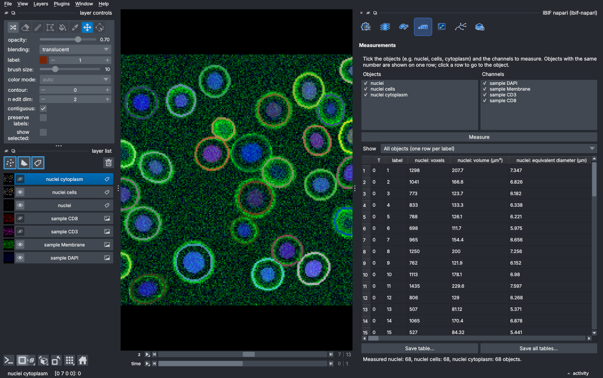

*The Measurements table. Nuclei, cells and cytoplasm with the same number are joined into one
row. Click a column header to sort; click a row to go to that object.*

1. Tick the **Objects** layers to measure (for example nuclei, cells and cytoplasm) and the
   **Channels**.
2. Click **Measure**. Every time point and position of the labels layers is measured.
3. **Show** chooses the table: one per objects layer, plus **All objects (one row per
   label)**, which joins objects with the same number into one row. Its columns are
   prefixed with the layer name, for example `nuclei: DAPI mean`.
4. **Save table…** writes the shown table as CSV or Excel; **Save all tables…** saves them
   all to a folder.

For each object (and time point / position) the table has:

| Column | Meaning |
|---|---|
| `T`, `P`, `label` | Time point, position and object number |
| `voxels` | Number of pixels (2D) or voxels (3D) |
| `volume (µm³)` / `area (µm²)` | Voxel count × voxel volume (pixel area in 2D) |
| `equivalent diameter (µm)` | Diameter of the sphere (3D) or disc (2D) with the same volume or area |
| `centroid Z / Y / X (µm)` | Centre of the object, in the image's coordinates |
| `<channel> mean`, `median`, `min`, `max`, `std` | Intensity statistics of the object's voxels in each channel |
| `<channel> sum` | Integrated intensity (sum over the object's voxels) |

**Interpreting intensities.** Intensity measurements are only as good as the acquisition
(Waters 2009):

- **Mean** intensity reflects concentration; **sum** (integrated) intensity reflects total
  amount, and scales with object size.
- Values are raw camera or detector counts and include the **background** (camera offset
  and out-of-focus light). Subtract a background measured in an empty region, or compare
  only images acquired identically.
- **Saturated** pixels (at the detector's maximum, e.g. 4095 or 65535) make measurements
  wrong. Check the `max` column.
- Compare intensities only between images taken with the **same** microscope settings
  (laser power, gain, exposure, objective).
- In 3D, objects deep in tissue look dimmer because of scattering and absorption.

---

## 10. Cytometry: gating, phenotypes and clustering

The **Cytometry** section turns measured objects into cell types, in the same way as flow
cytometry but on the image. You can gate objects on a scatter plot or on the image, build a
**hierarchy of phenotypes** (for example *T cell > CD8 T cell*), find types by clustering, and
show every type back on the image. The analysis is done by
[vtea-core](https://github.com/winfrees/vtea-python), the Python library of VTEA
(Volumetric Tissue Exploration and Analysis; Winfree et al. 2017). More detail is in
[docs/cytometry.md](../cytometry.md).

### 10.1 Choosing the objects

1. Measure the objects first ([section 9](#9-measurements)), including the marker channels.
2. In **Cytometry**, choose the **Objects** (a measurement table) and **On layer** (the labels
   layer they are in), then click **Use these objects**.
3. Click **Open Cytometry workbench**. The workbench is a separate window, so the plot can be
   large next to the image.

### 10.2 Gating

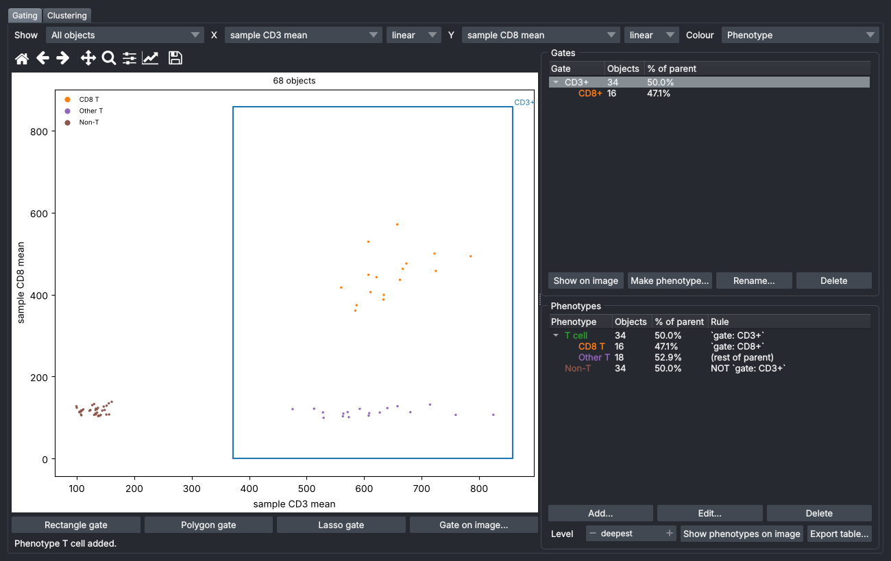

*The Gating tab: CD3 against CD8 mean intensity for every cell, coloured by phenotype, with
the gates and the phenotype hierarchy on the right.*

- **Show** chooses which objects are plotted: all of them, a gate, an image gate or a
  phenotype. A new gate is drawn **within** the shown objects, which is how subgates are
  made (for example *CD8+* within *CD3+*).
- **X** and **Y** can be any measurement, on a **linear**, **log10** or **asinh** scale. asinh
  (inverse hyperbolic sine) of x/150 behaves like a logarithm for bright objects but keeps
  zero and negative values. It is the usual transform for mass and imaging cytometry
  (Bendall et al. 2011).
- **Colour** the points by population, by phenotype or by any measurement.
- **Rectangle gate**, **Polygon gate** and **Lasso gate**: draw on the plot, then name the
  gate. For a polygon, click its corners and click the first corner again to close it.
- **Gate on image…** lets you draw regions on the image instead (for example a tumour
  region); an object is inside when its centre is inside a region.
- Click a point to go to that object in the viewer.

Set gates using controls: draw the *negative* gate on cells or regions known to lack the
marker, and use fluorescence-minus-one or secondary-only controls to decide where
*positive* starts. Guidelines from flow cytometry apply (Maecker et al. 2012).

### 10.3 Phenotypes

Select a gate and click **Make phenotype…** to turn it into a phenotype, choosing the
phenotype it belongs **within**. Or click **Add…** and write a rule, for example:

- `` `gate: CD3+` AND NOT `gate: CD4+` ``
- `` `CD8 mean` > 200 ``
- `` `image gate: tumour` ``

A phenotype with an empty rule is "the rest of its parent" (for example *Other T*). The tree
shows each phenotype's number of objects and its percentage of the parent.

**Show phenotypes on image** (in the panel or the workbench) colours every object by its
phenotype; **Level** chooses the level of the hierarchy. **Export table…** writes every object
with its gates, phenotype and phenotype path, as CSV or Excel.

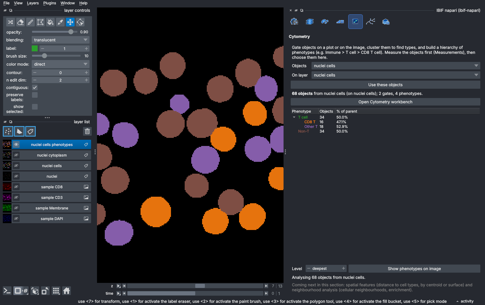

*Every cell coloured by its phenotype: CD8 T cells, other T cells and non-T cells.*

### 10.4 Clustering: finding cell types without gates

When there are many markers, or you do not know in advance which types are present,
*clustering* groups objects with similar measurements. The workbench's **Clustering** tab
does this:

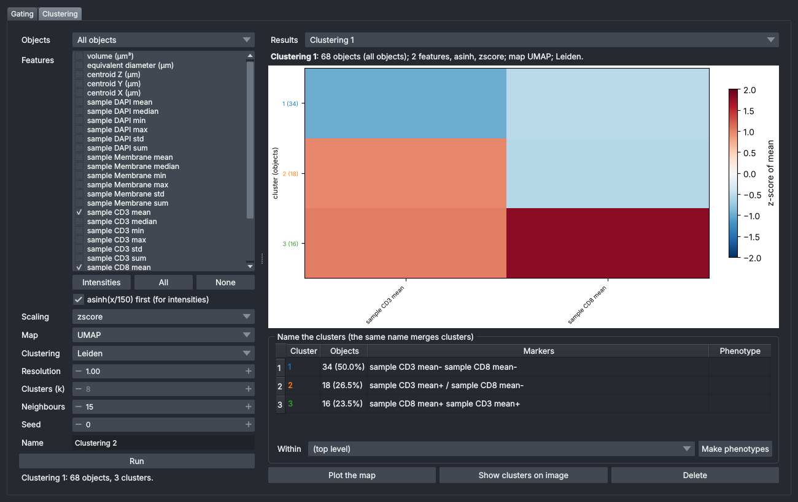

*The Clustering tab after a Leiden clustering of CD3 and CD8 mean intensities, with a UMAP map.
The heat map shows each cluster's average of each marker, and the table lists the markers that
distinguish them. The three clusters match the gated populations: CD3⁻CD8⁻ (non-T), CD3⁺
(other T) and CD3⁺CD8⁺ (CD8 T). Type a name under* Phenotype *and click* Make phenotypes
*to use them.*

- **Objects**: all, a gate or a phenotype. Clustering within a phenotype splits it further,
  so you can work from coarse to fine.
- **Features**: the measurements to cluster on. **Intensities** ticks the mean intensity of
  every channel. Choose markers that distinguish cell types; leave out size and position
  unless they matter.
- **asinh(x/150) first** compresses bright intensities; **Scaling** puts all features on
  one scale (z-score, robust median/IQR, min–max, or none), so that a bright marker does
  not dominate a dim one.
- **Map**: a 2D picture of the data for looking at it. **PCA** (principal component analysis)
  is linear and fast; **UMAP** (McInnes et al. 2018) and **t-SNE** (van der Maaten & Hinton
  2008) preserve local neighbourhoods and separate groups well. Distances and cluster
  sizes on UMAP and t-SNE maps are not meaningful; use them for looking, not measuring.
- **Clustering**:
  - **Leiden** (Traag et al. 2019) and **Louvain** (Blondel et al. 2008) find communities in
    a graph that joins each object to its nearest **Neighbours**, as PhenoGraph does
    (Levine et al. 2015). They choose the number of clusters themselves; higher
    **Resolution** gives more, smaller clusters.
  - **k-means** (Lloyd 1982) and **Gaussian mixture** make **k** clusters.
  - **k-means, best k** tries 2…k and keeps the best by the Bayesian information criterion
    (BIC; Schwarz 1978).
- **Seed**: the same seed gives the same result, which makes a run reproducible.

Click **Run**. The results show a heat map (the z-score of each feature's mean in each
cluster) and a table of each cluster's size and markers (for example *CD3 mean+ CD8
mean+*). Type a **phenotype name** next to clusters and click **Make phenotypes**; clusters
given the same name are merged. **Plot the map** puts the map on the Gating tab, where you
can gate on it, and **Show clusters on image** colours the objects by cluster.

> Clustering always produces clusters, even in data with no real structure. Check that
> clusters make biological sense: look at them on the image, compare their markers with known
> cell types, and check that they are stable with a different **Seed** or **Resolution**.

Everything (gates, phenotypes, clustering results) is saved with the workspace. Phenotypes are
saved as rules, so the same tree can be applied to the next sample.

---

## 11. Filament tracing

The **Filament tracing** section traces neurons, microtubules, vessels and other branched
filaments in 2D or 3D, and measures them. It works on the current time point and position,
and can be limited to a **Region** and **Z planes** as in Segmentation.

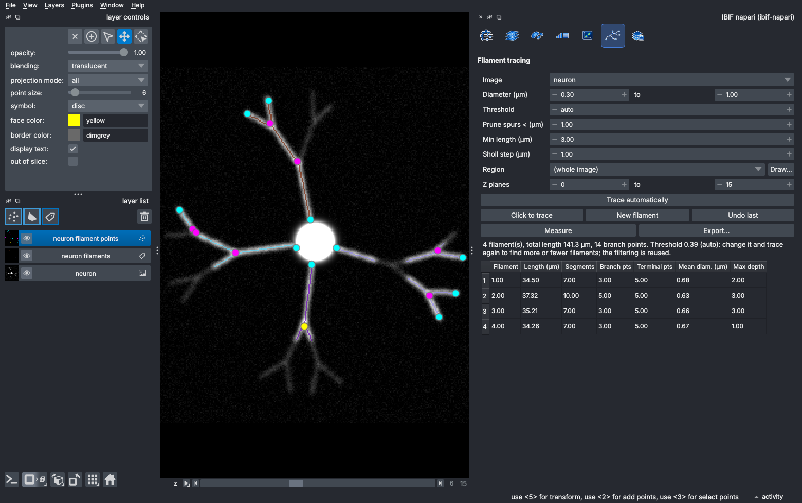

*An automatic trace of a synthetic neuron. Each filament has its own colour; root (yellow),
branch (magenta) and terminal (cyan) points are marked, and the statistics are in the table.*

### 11.1 Automatic tracing

1. Choose the **Image** (the channel with the filaments).
2. Set **Diameter (µm)** to the range of filament thicknesses, for example 0.3–1.5 µm for
   dendrites or 0.2–0.6 µm for microtubules.
3. Click **Trace automatically**. Results:
   - a **filaments** labels layer, coloured by filament;
   - a **filament points** layer: the root (yellow), branch points (magenta) and terminal
     points (cyan);
   - a table of filaments.
4. The status line shows the **Threshold** used. Raise it to keep only bright, clear
   filaments; lower it to find faint ones; then trace again (the slow filtering is reused).
   **Prune spurs** trims short side branches caused by noise; **Min length** drops short
   fragments.

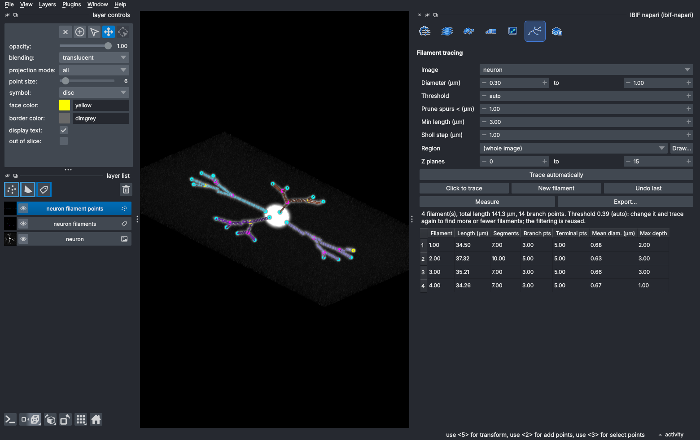

*The same trace in the 3D view.*

*How it works.* The image is filtered at several scales matching the diameter range with a
*tubeness* filter (Sato et al. 1998). It uses the eigenvalues of the Hessian matrix (the
second derivatives of the image), which are large and negative across a bright tube and
small along it, and it corrects for anisotropic voxels. The response is thresholded (Otsu
by default), *skeletonized* to one-voxel-wide centre lines (Lee et al. 1994), and analysed as
a graph of branches and junctions with [skan](https://skeleton-analysis.org) (Nunez-Iglesias
et al. 2018).

### 11.2 Click to trace

1. Click **Click to trace**. A *trace clicks* points layer is added.
2. In the 2D view, click along a filament on the plane where it is in focus. Each click
   traces the brightest path from the previous click, also across Z planes (a minimum-cost
   path through the filament response; Dijkstra 1959).
3. A click near an existing filament joins it. **New filament** starts somewhere new;
   **Undo last** removes the last piece.

Do the automatic trace first and then fix it up by clicking, because **Trace automatically**
replaces the filaments layer. To remove a wrong piece, erase it on the filaments layer and
click **Measure**.

### 11.3 Statistics and export

**Export…** saves:

- `<name>_filaments.csv`: per filament, total length, number of segments, branch and terminal
  points, mean diameter, volume, surface area, mean intensity, maximum branch depth,
  straightness and the root position;
- `<name>_segments.csv`: per segment (between branch or terminal points), type, length,
  straightness, diameter, intensity, branch depth, distance from the root and angle;
- `<name>_points.csv`: root, branch and terminal points;
- `<name>_sholl.csv`: Sholl analysis, the number of intersections with spheres every
  **Sholl step** µm from the root (Sholl 1953);
- `<name>.swc`: the tracing in the SWC format (Cannon et al. 1998), for neuron-morphology
  tools such as [SNT](https://imagej.net/plugins/snt/), neuTube or NeuroMorpho.org.

Notes: a cell body is a blob rather than a tube, so the filter responds weakly to it and
each dendrite leaving the soma may be reported as its own filament (as in the example above).
Join them with **Click to trace** if you need one tree per neuron. Lengths are in µm;
diameters come from the distance to the edge of the segmented
filament and are approximate near the resolution limit (filaments thinner than about
0.2–0.3 µm all look about as wide as the microscope's point spread function); the root is the
thickest point of each filament, usually the soma.

Two other filament plugins are installed and appear under **Plugins**:
**napari-tracing** (click-to-trace with SWC files) and, on Python 3.11 or newer,
**napari-filaments** (2D spline tracing).

---

## 12. Saving your work

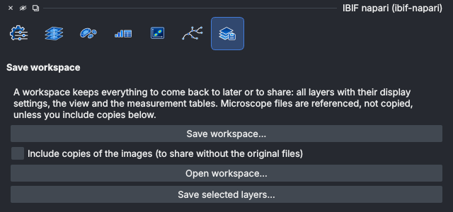

- **Save workspace…** saves everything in one `.ibif` folder: all layers with their display
  settings, the view, the measurement tables and the cytometry gates, phenotypes and
  clusters. Microscope files are *referenced*, not copied, and are found again if you move
  the workspace together with the data. Tick **Include copies of the images** to share the
  workspace with someone who does not have the original files.
- **Open workspace…** restores it. You can also drag the `.ibif` folder onto the window or
  run `ibif-napari my_analysis.ibif`.
- **Save selected layers…** writes the layers selected in the layer list as files: images and
  labels as TIFF (readable by Fiji/ImageJ), shapes and points as CSV.

Save a workspace for every analysis you report. It records exactly which segmentation and
gates produced your numbers.

---

## 13. Using a GPU server or cluster

3D Cellpose is much faster on an NVIDIA GPU (roughly 10–50× faster than a CPU). If your
computer has none, the facility may provide one:

- **Facility GPU server**: under **Run on** in Segmentation, choose the server (add it with
  **Servers…** and the access token the facility gives you). Only the selected region is
  sent. See [docs/facility-server.md](../facility-server.md).
- **GPU cluster (Slurm, e.g. NSF ACCESS)**: add the cluster with **Clusters…**, then choose
  it under **Run on** and click **Connect**. **Submit batch job** runs a whole series as one
  job, and you can close napari while it runs. See [docs/cluster.md](../cluster.md).

---

## 14. Good practice and reporting your analysis

Quantitative imaging is easy to get subtly wrong. A few habits make results trustworthy
and reproducible (Senft et al. 2023; Aaron & Chew 2021; Schmied et al. 2024):

**Before acquiring**

- Plan the analysis before imaging, including how many cells, fields and animals or
  patients you need. The biological replicate (animal, patient, culture) is the unit of
  statistics, not the cell.
- Acquire all conditions with identical settings, avoid saturation, and use Nyquist
  sampling where you can (pixel size about half the resolution).
- Include controls that define "positive": unstained, secondary-only or
  fluorescence-minus-one samples.

**During analysis**

- Check the voxel size and channel order of every file.
- Look at the segmentation on several fields and Z planes before measuring. Count the errors
  on a few fields if you can, and report them.
- Use the **same settings** for all conditions, and decide them on a subset before looking at
  the results. If possible, analyse blind to condition.
- Keep raw data unchanged. Display settings (contrast, colours) do not change measurements,
  but processing does.
- Save a workspace and the exported tables for each analysis.

**What to report in your methods section**

- Software and version: *IBIF napari* (version shown by `pip show ibif-napari`), napari,
  Cellpose and the model name (e.g. `cpsam_v2`), with citations.
- Segmentation settings: mode (3D or 2D stitched), diameter, flow and cell-probability
  thresholds, minimum size, and any manual corrections.
- Secondary objects: method, channel, threshold method and factor, distances.
- Measurements: which statistics, background subtraction, and units.
- Cytometry: transforms, gate positions and how they were chosen; for clustering, the
  features, scaling, map, method, its parameters and the seed.
- Filament tracing: diameter range, threshold, pruning and minimum length.

*Example.* "Nuclei were segmented in 3D from the DAPI channel with Cellpose 4
(`cpsam_v2`; Pachitariu et al. 2025) in IBIF napari 0.19.2 (napari 0.7), with automatic
diameter and default flow (0.4) and cell-probability (0) thresholds. Cells were grown from the
nuclei by a seeded watershed of the membrane channel within an Otsu foreground, at most
3 µm from each nucleus. Mean intensities of CD3 and CD8 were measured
per cell; CD3⁺ and CD8⁺ gates were set from secondary-only controls on asinh-transformed
intensities."

---

## 15. Can I trust the numbers? Verification and validation

IBIF napari includes a verification and validation (V&V) suite. It generates synthetic images
whose true content is known exactly, runs the same code the panels use, compares the results
with the truth, and writes a report. Segmentation is scored with standard metrics such as F1
and average precision at an intersection-over-union threshold (Caicedo et al. 2019) and
panoptic quality (Kirillov et al. 2019); volumes, centroids and intensities are compared
with their true values.

```bash
ibif-napari-vv all vv          # then open vv/results/report.html
```

The requirements and how to read the report are described in [docs/vv/README.md](../vv/README.md)
and [docs/vv/requirements.md](../vv/requirements.md). Synthetic tests show that the software
measures correctly; they cannot show that Cellpose segments *your* images well. Check that
on your own data, as described in [section 7.5](#75-checking-and-correcting-the-result).

---

## 16. Troubleshooting

| Problem | What to do |
|---|---|
| `resolution-too-deep` during `pip install` | Update to the latest version, which constrains its dependencies. Use a fresh environment. |
| Cellpose does not use the GPU | Check `python -c "import torch; print(torch.cuda.is_available())"`. If it prints `False`, install the CUDA build of PyTorch from [pytorch.org](https://pytorch.org/get-started/locally/), then make sure **Use GPU** is ticked. |
| The first run is slow or seems stuck | The first run downloads the model weights (about 1.2 GB) into `~/.cellpose/models`. The panel shows the progress. If your network blocks huggingface.co, run `ibif-napari --download-models` elsewhere and copy the folder. |
| 3D segmentation is very slow | Use a **Region** and **Z planes**, the 2D stitched mode, a GPU, or the facility server or cluster. |
| Objects look squashed or stretched in 3D | The voxel size is wrong or missing; check the layer's scale. |
| Many merged or split objects | Set **Diameter**; adjust **Flow threshold** and **Cell probability**; try another model; train a custom model. |
| Cells leak into each other in Secondary objects | Use **Max distance**, raise **Threshold ×**, increase **Smoothing**, or switch between *Membranes* and *Cytoplasm*. |
| Whole cells look like rings, or a membrane gets the wrong cell's colour | Update to version 0.19.2 or later, which fills membrane-enclosed cell interiors. If the membrane has gaps, lower **Threshold ×** or increase **Smoothing** ([section 8](#8-secondary-objects-cells-cytoplasm-rings-and-rims)). |
| A CZI or LIF file reports a missing package | `pip install bioio-czi bioio-lif` |
| Something else | Start `ibif-napari` from a terminal and read the messages there; report problems at [github.com/CU-IBIF/Napari_Cellpose/issues](https://github.com/CU-IBIF/Napari_Cellpose/issues). |

---

## 17. Glossary

| Term | Meaning |
|---|---|
| **Anisotropy** | Ratio of Z step to XY pixel size; voxels are not cubes |
| **asinh transform** | Inverse hyperbolic sine; log-like for large values, linear near zero |
| **Centroid** | Centre of mass of an object |
| **Channel** | Image of one fluorophore |
| **Gate** | A region on a scatter plot (or image) that selects objects |
| **Labels image** | Image whose values are object numbers (0 = background) |
| **Layer** | One item in napari's layer list: image, labels, shapes, points |
| **Maximum-intensity projection** | 2D image with the brightest value along Z at each pixel |
| **Phenotype** | A named cell type defined by gates or rules, arranged in a hierarchy |
| **Primary / secondary objects** | Objects found directly (e.g. nuclei) / built from them (e.g. cells) |
| **Seeded watershed** | Region growing from seeds over an image "landscape"; regions meet at ridges |
| **Segmentation** | Assigning every pixel to an object or background |
| **Skeleton** | One-voxel-wide centre line of a shape |
| **Sholl analysis** | Counting branch crossings at increasing distances from the cell body |
| **Voxel** | 3D pixel, with a size in µm |

---

## 18. References

**Software**

- napari: Sofroniew N, Lambert T, Bokota G, et al. napari: a multi-dimensional image viewer for
  Python. Zenodo. [doi:10.5281/zenodo.3555620](https://doi.org/10.5281/zenodo.3555620)
- scikit-image: van der Walt S, Schönberger JL, Nunez-Iglesias J, et al. scikit-image: image
  processing in Python. *PeerJ* 2:e453 (2014). [doi:10.7717/peerj.453](https://doi.org/10.7717/peerj.453)
- skan: Nunez-Iglesias J, Blanch AJ, Looker O, Dixon MW, Tilley L. A new Python library to
  analyse skeleton images confirms malaria parasite remodelling of the red blood cell
  membrane skeleton. *PeerJ* 6:e4312 (2018). [doi:10.7717/peerj.4312](https://doi.org/10.7717/peerj.4312)
- VTEA: Winfree S, Khan S, Micanovic R, et al. Quantitative three-dimensional tissue cytometry
  to study kidney tissue and resident immune cells. *J Am Soc Nephrol* 28:2108–2118 (2017).
  [doi:10.1681/ASN.2016091027](https://doi.org/10.1681/ASN.2016091027);
  vtea-core: [github.com/winfrees/vtea-python](https://github.com/winfrees/vtea-python)
- CellProfiler: Stirling DR, Swain-Bowden MJ, Lucas AM, Carpenter AE, Cimini BA, Goodman A.
  CellProfiler 4: improvements in speed, utility and usability. *BMC Bioinformatics* 22:433
  (2021). [doi:10.1186/s12859-021-04344-9](https://doi.org/10.1186/s12859-021-04344-9)

**Segmentation**

- Stringer C, Wang T, Michaelos M, Pachitariu M. Cellpose: a generalist algorithm for cellular
  segmentation. *Nat Methods* 18:100–106 (2021). [doi:10.1038/s41592-020-01018-x](https://doi.org/10.1038/s41592-020-01018-x)
- Pachitariu M, Stringer C. Cellpose 2.0: how to train your own model. *Nat Methods*
  19:1634–1641 (2022). [doi:10.1038/s41592-022-01663-4](https://doi.org/10.1038/s41592-022-01663-4)
- Stringer C, Pachitariu M. Cellpose3: one-click image restoration for improved cellular
  segmentation. *Nat Methods* 22:592–599 (2025). [doi:10.1038/s41592-025-02595-5](https://doi.org/10.1038/s41592-025-02595-5)
- Pachitariu M, Rariden M, Stringer C. Cellpose-SAM: superhuman generalization for cellular
  segmentation. *bioRxiv* (2025). [doi:10.1101/2025.04.28.651001](https://doi.org/10.1101/2025.04.28.651001)
- Vincent L, Soille P. Watersheds in digital spaces: an efficient algorithm based on
  immersion simulations. *IEEE Trans Pattern Anal Mach Intell* 13:583–598 (1991).
  [doi:10.1109/34.87344](https://doi.org/10.1109/34.87344)
- Neubert P, Protzel P. Compact watershed and preemptive SLIC. *Proc. 22nd International
  Conference on Pattern Recognition* (2014). [doi:10.1109/ICPR.2014.181](https://doi.org/10.1109/ICPR.2014.181)
- Jones TR, Carpenter A, Golland P. Voronoi-based segmentation of cells on image manifolds.
  *Computer Vision for Biomedical Image Applications*, LNCS 3765:535–543 (2005).
  [doi:10.1007/11569541_54](https://doi.org/10.1007/11569541_54)
- Otsu N. A threshold selection method from gray-level histograms. *IEEE Trans Syst Man
  Cybern* 9:62–66 (1979). [doi:10.1109/TSMC.1979.4310076](https://doi.org/10.1109/TSMC.1979.4310076)
- Li CH, Tam PKS. An iterative algorithm for minimum cross entropy thresholding. *Pattern
  Recognit Lett* 19:771–776 (1998). [doi:10.1016/S0167-8655(98)00057-9](https://doi.org/10.1016/S0167-8655(98)00057-9)
- Zack GW, Rogers WE, Latt SA. Automatic measurement of sister chromatid exchange frequency.
  *J Histochem Cytochem* 25:741–753 (1977). [doi:10.1177/25.7.70454](https://doi.org/10.1177/25.7.70454)

**Cytometry and clustering**

- Bendall SC, Simonds EF, Qiu P, et al. Single-cell mass cytometry of differential immune and
  drug responses across a human hematopoietic continuum. *Science* 332:687–696 (2011).
  [doi:10.1126/science.1198704](https://doi.org/10.1126/science.1198704)
- Maecker HT, McCoy JP, Nussenblatt R. Standardizing immunophenotyping for the Human
  Immunology Project. *Nat Rev Immunol* 12:191–200 (2012). [doi:10.1038/nri3158](https://doi.org/10.1038/nri3158)
- McInnes L, Healy J, Melville J. UMAP: Uniform Manifold Approximation and Projection for
  dimension reduction. *arXiv* 1802.03426 (2018). [arxiv.org/abs/1802.03426](https://arxiv.org/abs/1802.03426)
- van der Maaten L, Hinton G. Visualizing data using t-SNE. *J Mach Learn Res* 9:2579–2605
  (2008). [jmlr.org/papers/v9/vandermaaten08a.html](https://www.jmlr.org/papers/v9/vandermaaten08a.html)
- Traag VA, Waltman L, van Eck NJ. From Louvain to Leiden: guaranteeing well-connected
  communities. *Sci Rep* 9:5233 (2019). [doi:10.1038/s41598-019-41695-z](https://doi.org/10.1038/s41598-019-41695-z)
- Blondel VD, Guillaume JL, Lambiotte R, Lefebvre E. Fast unfolding of communities in large
  networks. *J Stat Mech* P10008 (2008). [doi:10.1088/1742-5468/2008/10/P10008](https://doi.org/10.1088/1742-5468/2008/10/P10008)
- Levine JH, Simonds EF, Bendall SC, et al. Data-driven phenotypic dissection of AML reveals
  progenitor-like cells that correlate with prognosis. *Cell* 162:184–197 (2015).
  [doi:10.1016/j.cell.2015.05.047](https://doi.org/10.1016/j.cell.2015.05.047)
- Lloyd SP. Least squares quantization in PCM. *IEEE Trans Inf Theory* 28:129–137 (1982).
  [doi:10.1109/TIT.1982.1056489](https://doi.org/10.1109/TIT.1982.1056489)
- Schwarz G. Estimating the dimension of a model. *Ann Stat* 6:461–464 (1978).
  [doi:10.1214/aos/1176344136](https://doi.org/10.1214/aos/1176344136)

**Filament tracing**

- Sato Y, Nakajima S, Shiraga N, et al. Three-dimensional multi-scale line filter for
  segmentation and visualization of curvilinear structures in medical images. *Med Image
  Anal* 2:143–168 (1998). [doi:10.1016/S1361-8415(98)80009-1](https://doi.org/10.1016/S1361-8415(98)80009-1)
- Lee TC, Kashyap RL, Chu CN. Building skeleton models via 3-D medial surface/axis thinning
  algorithms. *CVGIP: Graph Models Image Process* 56:462–478 (1994).
  [doi:10.1006/cgip.1994.1042](https://doi.org/10.1006/cgip.1994.1042)
- Dijkstra EW. A note on two problems in connexion with graphs. *Numer Math* 1:269–271 (1959).
  [doi:10.1007/BF01386390](https://doi.org/10.1007/BF01386390)
- Sholl DA. Dendritic organization in the neurons of the visual and motor cortices of the
  cat. *J Anat* 87:387–406 (1953). [PMC1244622](https://www.ncbi.nlm.nih.gov/pmc/articles/PMC1244622/)
- Cannon RC, Turner DA, Pyapali GK, Wheal HV. An on-line archive of reconstructed hippocampal
  neurons. *J Neurosci Methods* 84:49–54 (1998). [doi:10.1016/S0165-0270(98)00091-0](https://doi.org/10.1016/S0165-0270(98)00091-0)

**Evaluation and good practice**

- Caicedo JC, Goodman A, Karhohs KW, et al. Nucleus segmentation across imaging experiments:
  the 2018 Data Science Bowl. *Nat Methods* 16:1247–1253 (2019).
  [doi:10.1038/s41592-019-0612-7](https://doi.org/10.1038/s41592-019-0612-7)
- Kirillov A, He K, Girshick R, Rother C, Dollár P. Panoptic segmentation. *Proc. IEEE/CVF
  CVPR* 9404–9413 (2019). [doi:10.1109/CVPR.2019.00963](https://doi.org/10.1109/CVPR.2019.00963)
- Waters JC. Accuracy and precision in quantitative fluorescence microscopy. *J Cell Biol*
  185:1135–1148 (2009). [doi:10.1083/jcb.200903097](https://doi.org/10.1083/jcb.200903097)
- Aaron J, Chew TL. A guide to accurate reporting in digital image processing — can anyone
  reproduce your quantitative analysis? *J Cell Sci* 134:jcs254151 (2021).
  [doi:10.1242/jcs.254151](https://doi.org/10.1242/jcs.254151)
- Senft RA, Diaz-Rohrer B, Colarusso P, et al. A biologist's guide to planning and performing
  quantitative bioimaging experiments. *PLoS Biol* 21:e3002167 (2023).
  [doi:10.1371/journal.pbio.3002167](https://doi.org/10.1371/journal.pbio.3002167)
- Schmied C, Nelson MS, Avilov S, et al. Community-developed checklists for publishing images
  and image analyses. *Nat Methods* 21:170–181 (2024).
  [doi:10.1038/s41592-023-01987-9](https://doi.org/10.1038/s41592-023-01987-9)
